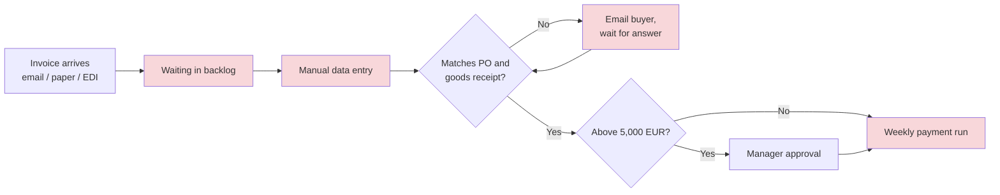
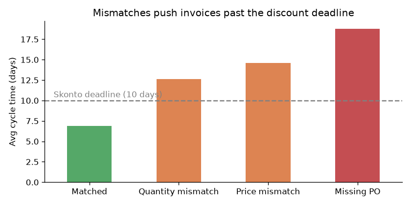
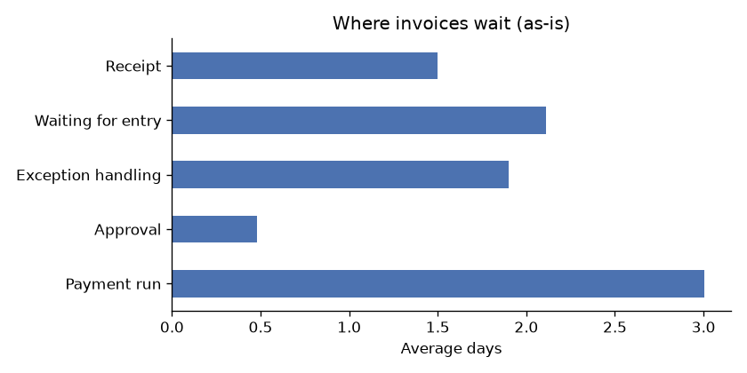
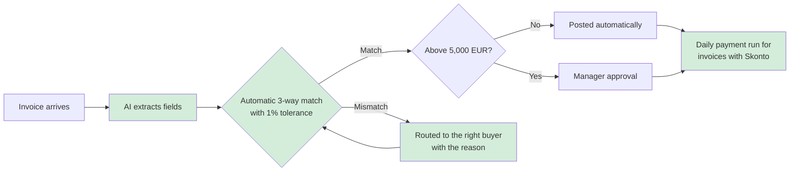
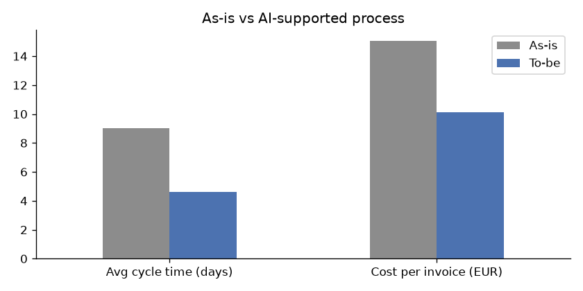

# Invoice processing: from process analysis to EBIT impact

A business analysis project on supplier invoice processing (accounts payable) in a mid-sized German manufacturing company. I mapped the current process, analysed one year of invoice data to find where time and money get lost, and built a small prototype of an AI-supported process. Then I calculated what the change would be worth per year.

> **Note:** the company and data are fictional. I generated the dataset myself (`data/generate_data.py`) based on typical patterns in manual accounts payable, so the numbers show the method, not a real company.

## The problem

The finance team handles about 12,000 supplier invoices a year, mostly by hand. Invoices arrive as PDFs or on paper, get typed into the ERP, and are checked against the purchase order and goods receipt. When something doesn't match, a clerk emails the buyer and waits.

The question I wanted to answer: **where exactly does this process lose money, and which changes pay off first?**

## Current process (as-is)



Red = where invoices wait or need manual work.

## What the data shows

| KPI | As-is |
|---|---|
| Average cycle time (invoice date to payment) | 9.0 days |
| First-pass match rate | 74% |
| Invoices with discount paid in time | 67% |
| Early-payment discount (Skonto) lost per year | **€239k** of €565k possible |
| Manual handling | ~4,000 hours/year, €15 per invoice |

**1. The biggest cost isn't labour, it's lost Skonto.** The company loses about €239k a year in early-payment discounts, four times more than it could save on clerk time.

**2. Exceptions are slow, but they're not the whole story.** Invoices with a mismatch or missing PO take 13–19 days, far past the 10-day discount window.



But almost half of the lost Skonto (€117k) comes from invoices that matched perfectly. They simply wait too long, first in the entry backlog and then for the weekly payment run.



**3. Paper is expensive.** Paper invoices are 31% of the volume but cause about half the lost Skonto. EDI invoices lose almost nothing.

**4. A few suppliers matter most.** The top 5 suppliers (four of them raw materials) cause 46% of the lost Skonto (see query 6 in `sql/analysis.sql`). These are the first candidates to move to e-invoicing.

## Proposed process (to-be)



Four changes:
1. **AI extraction** of invoice data from PDFs and scans instead of manual typing
2. **Tolerance rules** that accept small price differences automatically
3. **Automatic routing** of real exceptions to the responsible buyer, with the reason
4. **Skonto-aware payment**: invoices with a discount go into a daily payment run

The prototype in `automation/invoice_triage.py` shows how steps 1–3 work on sample invoices. It extracts the data (with regex rules, or with the Claude API if a key is set), checks it against the PO and goods receipt, and builds a work queue sorted by discount deadline. The AI only reads the invoice. The decision is made by fixed rules a finance team can check and audit.

## Business case

| | As-is | To-be | Change |
|---|---|---|---|
| Avg cycle time | 9.0 days | 4.6 days | −49% |
| Discount paid in time | 67% | 95% | +28 pts |
| Skonto lost / year | €239k | €51k | **+€188k** |
| Manual hours / year | 4,016 | 2,698 | **+€59k** |
| Cost per invoice | €15.06 | €10.12 | −33% |

**Estimated EBIT effect: about €247k per year**, mostly from captured discounts.



The assumptions (minutes per touch, cost per hour, AI straight-through rate etc.) are at the top of `analysis/analysis.py` so they're easy to change. With more conservative values (60% straight-through, 25% auto-resolved mismatches, 30% faster exceptions) the result is still about €186k, because most of the value comes from the daily payment run.

## What I'd do next in a real project

- Validate the numbers with real ERP data (e.g. an SAP S/4HANA export) and process mining in Celonis
- Interview the AP team and buyers about why exceptions take so long
- Start with a pilot: the top 5 suppliers and the daily payment run, since that's the quickest win
- Track the KPIs in a dashboard (Power BI or SAP Analytics Cloud)
- Check risks: extraction errors, audit requirements, and acceptance in the team

## Project structure

```
data/         generate_data.py, invoices.csv (12,000 synthetic invoices)
sql/          load_to_sqlite.py, analysis.sql (KPI and root-cause queries)
analysis/     analysis.py (KPIs, to-be simulation, business case, charts)
automation/   invoice_triage.py, sample invoices, purchase orders
images/       charts used in this README
```

## How to run

```bash
pip install -r requirements.txt

python data/generate_data.py          # create the dataset
python analysis/analysis.py           # KPIs, business case, charts
python sql/load_to_sqlite.py          # load data into SQLite
sqlite3 invoices.db < sql/analysis.sql
python automation/invoice_triage.py   # run the prototype
```

**Tools:** Python (pandas, matplotlib), SQL (SQLite), Mermaid/BPMN-style process maps, Claude API (optional)
